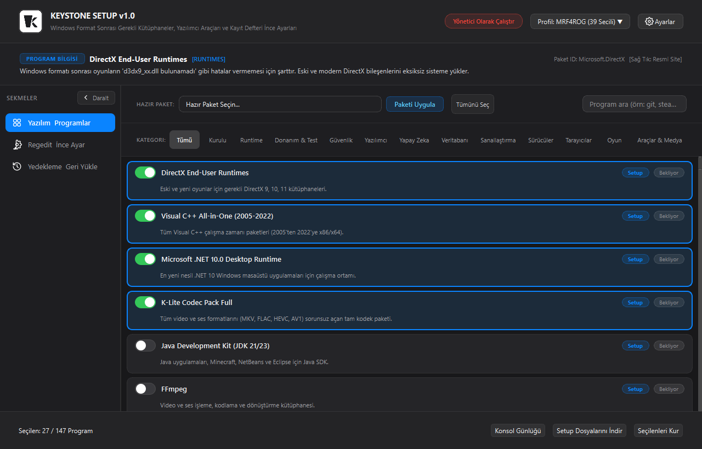
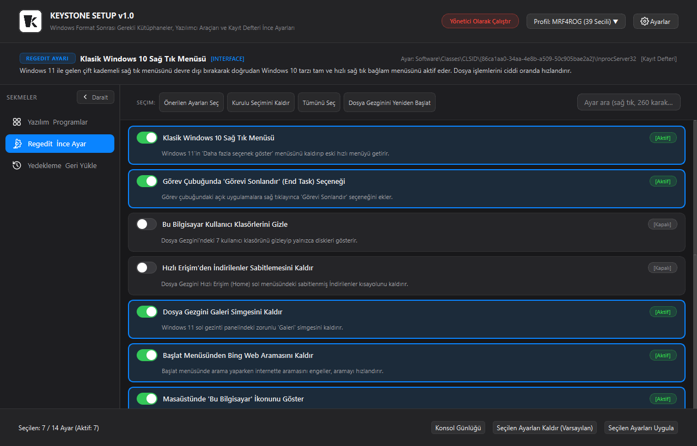
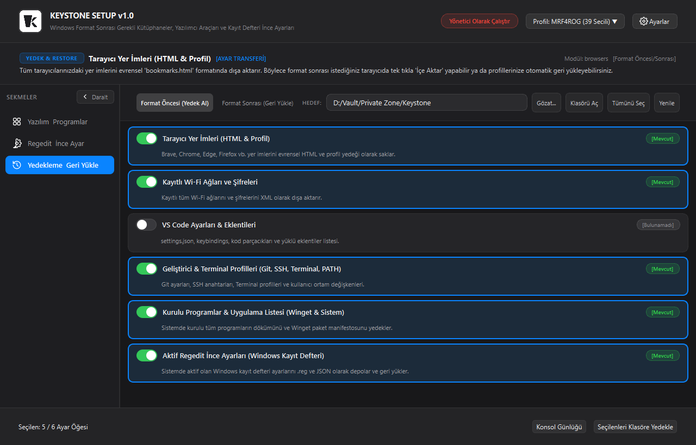
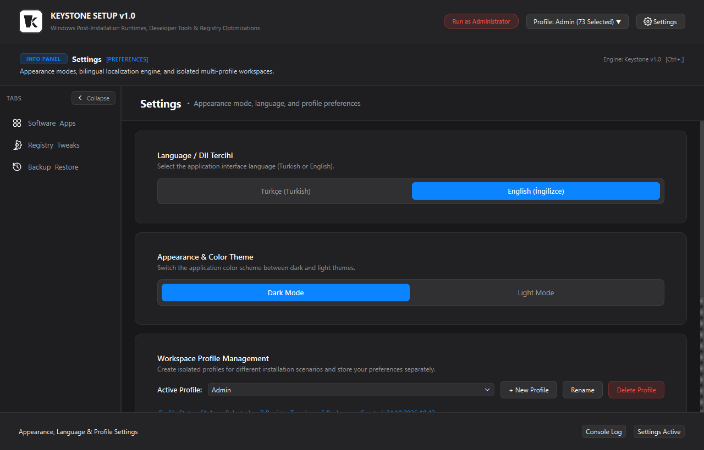
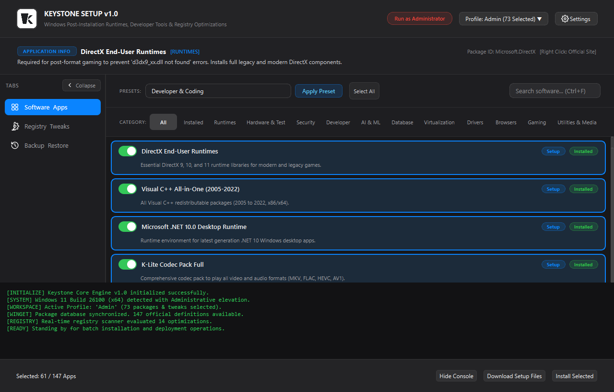
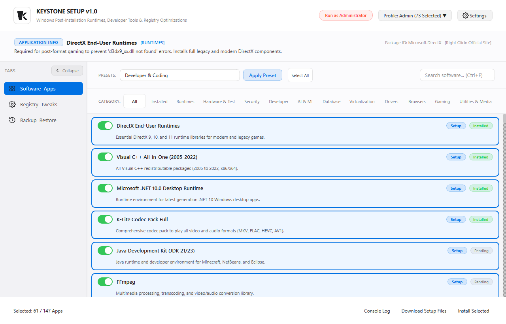

# Keystone

**Automated Post-Installation Deployment, System Optimization, and Configuration Migration Platform for Windows**

[](https://microsoft.com/windows)
[](https://python.org)
[](https://riverbankcomputing.com/software/pyqt/)
[](https://github.com)
[](LICENSE)

---

## Table of Contents

- [Overview](#overview)
- [Interface Showcase](#interface-showcase)
  - [1. Software Catalog & Silent Deployment](#1-software-catalog--package-deployment-dark-mode)
  - [2. Validated Windows Registry Optimizations](#2-windows-registry-optimizations-dark-mode)
  - [3. Configuration Backup & System Migration](#3-configuration-backup--system-migration-dark-mode)
  - [4. Workspace Profiles & Preferences](#4-workspace-profiles--preferences-dark-mode)
  - [5. Live Terminal & Process Monitoring](#5-live-terminal--process-monitoring-dark-mode)
  - [6. High-Contrast Light Theme](#6-high-contrast-light-theme)
- [Core Capabilities](#core-capabilities)
  - [Curated Software Deployment Engine](#1-curated-software-deployment-engine)
  - [Validated Windows Registry Optimizations](#2-validated-windows-registry-optimizations)
  - [Pre-Format Backup & Post-Format Migration](#3-pre-format-backup--post-format-migration)
  - [Isolated Multi-Profile Architecture](#4-isolated-multi-profile-architecture)
- [Architecture & Repository Structure](#architecture-and-repository-structure)
- [Installation & Execution](#installation--execution)
  - [Standalone Executable](#standalone-executable-releases)
  - [Running from Source](#running-from-source)
  - [Building the Executable](#building-the-standalone-executable)
- [Keyboard Shortcuts](#keyboard-shortcuts)
- [License](#license)

---

## Overview

**Keystone** is a native, high-performance desktop utility engineered to eliminate the repetitive friction and manual configuration required following a clean Windows installation. Instead of navigating dozens of vendor websites, running disparate setup scripts, or manually editing registry keys, Keystone consolidates all post-installation workflows into an integrated, portable workstation manager.

### Key Highlights

- **Native Desktop Engine**: Built entirely with native **PyQt6** and Win32 APIs — zero Electron or Chromium webview overhead, resulting in instant launch times and minimal resource utilization.
- **One-Click Silent Provisioning**: Automatically installs runtimes (DirectX, VC++ All-in-One, .NET), developer tools, browsers, and daily utilities via Windows Package Manager (Winget) and verified silent vendor arguments.
- **Real-Time Registry State Inspection**: Live inspection of Windows Registry hives (`HKCU` and `HKLM`) with automatic shell refresh (`SHChangeNotify`), eliminating required system reboots for most tweaks.
- **Zero-Loss Configuration Migration**: Exports and restores browser bookmarks (universal HTML), Wi-Fi security keys (XML), VS Code configurations, developer workspaces (Git, SSH, PowerShell), and active registry manifests.
- **Browser-Style Isolated Profiles**: Supports independent workstation configurations (e.g., Gaming Rig, Developer Workstation, Minimal Daily) where selections, tweaks, and backup targets remain completely isolated.
- **Bilingual Interface**: Native support for both **English** and **Turkish**, selectable with a single click.

---

## Interface Showcase

All user interface previews below reflect the actual live application in **English** using native Windows styling:

### 1. Software Catalog & Package Deployment (Dark Mode)
Curated catalog of 140+ applications organized across 12 categories with interactive preset bundles, dynamic status badges, and top-tier intelligence inspection.


### 2. Windows Registry Optimizations (Dark Mode)
Validated system tweaks with real-time active registry detection, single-click Explorer shell restarts, and non-destructive system defaults.


### 3. Configuration Backup & System Migration (Dark Mode)
Full-spectrum pre-format backup and post-format restoration of browser profiles, Wi-Fi credentials, developer keys, and package manifests.


### 4. Workspace Profiles & Preferences (Dark Mode)
Centralized preferences for dynamic theme switching, bilingual localization, and browser-style isolated profile management.


### 5. Live Terminal & Process Monitoring (Dark Mode)
Embedded slide-up execution console tracking PowerShell, Winget, and registry modification commands with full real-time logging.


### 6. High-Contrast Light Theme
Modern, polished light appearance mode with carefully calibrated contrast ratios inspired by modern human interface guidelines.


---

## Core Capabilities

### 1. Curated Software Deployment Engine
- **Direct & Silent Provisioning**: Automates silent installations using the Windows Package Manager (`winget`) or direct vendor installers with verified silent flags (`/S`, `/VERYSILENT`, `/qn`, `/passive`).
- **Comprehensive Ecosystem (140+ Packages)**:
  - **Essential Runtimes**: DirectX 9/10/11 End-User Runtimes, Visual C++ All-in-One Redistributables (2005–2022 x86/x64), Microsoft .NET Desktop Runtime, K-Lite Codec Pack Full, OpenJDK/Java Development Kit.
  - **Developer Tools**: Git for Windows, Python 3, Visual Studio Code, Visual Studio 2022 Community, JetBrains IDEs (PyCharm, IntelliJ), Docker Desktop, Node.js (LTS), Windows Terminal, Postman, Sublime Text 4.
  - **Web Browsers**: Brave Browser, Mozilla Firefox, Arc Browser, Google Chrome, Opera GX, Microsoft Edge.
  - **AI & Data Science**: Ollama Local LLM, Anaconda Distribution, ChatGPT Desktop, Cursor Editor, Antigravity IDE.
  - **Gaming & Virtualization**: Steam, Epic Games Launcher, Discord, VMware Workstation, Oracle VirtualBox.
  - **System Utilities & Security**: 7-Zip, WinRAR, KeePassXC, Bitwarden, Everything Search, ShareX, Obsidian, PowerToys, GIMP.
- **Offline Setup Downloader**: Download original setup files directly to a local or external drive for offline or air-gapped system deployments.
- **Dynamic Package Detection**: Automatically queries local package databases and system uninstall hives on startup to indicate installed applications.
- **Top Intelligence HUD**: Displays package descriptions, download sources, categories, and one-click official website redirection.

### 2. Validated Windows Registry Optimizations
- **Productivity & Interface Tweaks**: Restores Windows 10 Classic Context Menu on Windows 11, enables Taskbar "End Task" on right-click, removes Explorer duplicate user folders, and removes the Windows 11 Gallery navigation node.
- **Telemetry & Resource Management**: Minimizes diagnostic telemetry, disables Bing web search injection in Start Menu, disables hibernation (`hiberfil.sys`) to reclaim RAM-equivalent disk space, and speeds up system shutdown timeouts.
- **Real-Time State Validation**: Actively inspects Windows Registry hives (`HKCU` and `HKLM`) to report live configuration states (`[Active]` or `[Disabled]`) and synchronizes switch toggles automatically.
- **Explorer Shell Refresh**: Automatically triggers Windows Shell notification (`SHChangeNotify`) and safely restarts `explorer.exe` when shell-level modifications require immediate activation.

### 3. Pre-Format Backup & Post-Format Migration
- **Browser Bookmarks & Profiles**: Exports universal Netscape `bookmarks.html` and profile configurations across Chromium browsers (Chrome, Brave, Edge, Opera, Vivaldi) and Mozilla Firefox.
- **Wi-Fi Network Credentials**: Exports all saved wireless network profiles with decrypted security keys to XML and restores them on fresh installations.
- **Developer Workspaces**: Consolidates `~/.gitconfig`, `~/.ssh` keys, Windows Terminal configuration (`settings.json`), PowerShell profiles (`$PROFILE`), and User `PATH` environment variables.
- **VS Code Configuration**: Backs up user settings, custom keybindings, snippets, and installed extension lists with automated reinstallation post-format.
- **Installed Software Manifests**: Generates structured `installed_programs.json` and `kurulu_programlar.txt` reports along with `winget_packages.json` export manifests for one-click re-deployment.
- **Active Registry Tweaks**: Generates valid `aktif_regedit_ayarlari.reg` files and JSON manifests to re-apply personalized optimizations seamlessly.

### 4. Isolated Multi-Profile Architecture
- **Browser-Style Profiles**: Independent user profiles allowing distinct application selections, optimization lists, and backup paths (e.g., "Developer Setup", "Gaming Rig", "Clean Workstation").
- **Portable Persistence**: Stores configuration in `profiles.json` adjacent to the executable or in `%APPDATA%/Keystone` when installed.

---

## Architecture and Repository Structure

```
Keystone/
|-- assets/                      # Vector graphics, icons, custom fonts, toggle assets
|   |-- fonts/                   # Bundled custom pixel typography
|   |-- icons/                   # High-res SVG & PNG icons
|   |-- screenshots/             # In-app documentation interface previews (English)
|   |   |-- preview_apps.png     # Software Catalog view
|   |   |-- preview_tweaks.png   # Registry Optimizations view
|   |   |-- preview_backup.png   # Backup & Migration view
|   |   |-- preview_settings.png # Preferences & Profiles view
|   |   |-- preview_console.png  # Live Terminal Console view
|   |   |-- preview_light.png    # Light Mode Theme view
|-- data/
|   |-- packages.py              # 140+ package catalog, winget IDs, silent flags, presets
|   |-- tweaks.py                # Registry optimizations, hive definitions, key values
|-- installer.py                 # Multithreaded background download & installation worker
|-- tweaks_manager.py            # Win32 registry read/write engine, shell hooks
|-- backup_manager.py            # Pre/post-format backup and restoration pipelines
|-- profile_manager.py           # Multi-profile workspace persistence and isolation
|-- locales.py                   # Bilingual (English & Turkish) localization engine
|-- styles.py                    # Apple-inspired Qt Style Sheets (QSS) design system
|-- ui_main.py                   # Primary application window layout, HUD intelligence
|-- ui_card.py                   # Software package card widget with Apple-style toggle
|-- ui_tweak_card.py             # Registry tweak card widget with status detection
|-- ui_backup_card.py            # Backup and recovery item card widget
|-- ui_profile_menu.py           # Profile management dialogs and context actions
|-- generate_screenshots.py      # Automated snapshot generator for repository docs
|-- build_exe.py                 # PyInstaller standalone binary compilation script
|-- main.py                      # Application entry point, DPI scaling, and elevation
|-- utils.py                     # Administrative privilege checks and shell helpers
|-- LICENSE                      # MIT Open-Source License
|-- README.md                    # Project documentation
```

---

## Installation & Execution

### Standalone Executable (Releases)

Pre-compiled standalone binaries with all runtime dependencies bundled are published under GitHub Releases:
- **Download Latest**: [Keystone Standalone Executable (Releases)](https://github.com/furkanndev/KeyStone/releases)
- **Requirements**: Windows 10 (Build 19041+) or Windows 11 (64-bit).
- **Run as Administrator**: Right-click `Keystone.exe` and select **Run as Administrator** (required for DirectX runtimes, Visual C++, and system-wide registry modifications).

---

### Running from Source

#### 1. Clone the repository
```powershell
git clone https://github.com/furkanndev/KeyStone.git
cd KeyStone
```

#### 2. Install dependencies
```powershell
pip install PyQt6
```

#### 3. Launch Keystone
```powershell
python main.py
```

---

### Building the Standalone Executable

To produce a single portable `.exe` with all assets, icons, fonts, and dependencies bundled:

```powershell
python build_exe.py
```

The compiled binary will be placed at `dist/Keystone.exe` and copied to the project root.

---

## Keyboard Shortcuts

| Shortcut | Scope | Action |
|:---|:---|:---|
| `Ctrl+A` | Active Tab | Select all / Deselect all visible items |
| `Ctrl+F` | Global | Focus search input bar |
| `Ctrl+T` | Global | Toggle Dark / Light theme |
| `Ctrl+,` | Global | Open Settings & Preferences |
| `Ctrl+B` | Global | Collapse / Expand navigation sidebar |
| `Escape` | Global | Clear active search query or return to default view |

---

## Administrative Privileges & Safety

Keystone operates with full administrative transparency:
- **Zero Third-Party Telemetry**: Keystone contains no analytics, ad trackers, or background telemetry.
- **Non-Destructive Registry Optimizations**: Every registry modification can be reverted to original Windows defaults using the dedicated **Revert Selected Tweaks** option.
- **Direct Official Sources**: Package installations download official signed binaries directly from Microsoft and vendor CDN servers through Winget.

---

## License

This project is licensed under the [MIT License](LICENSE).
