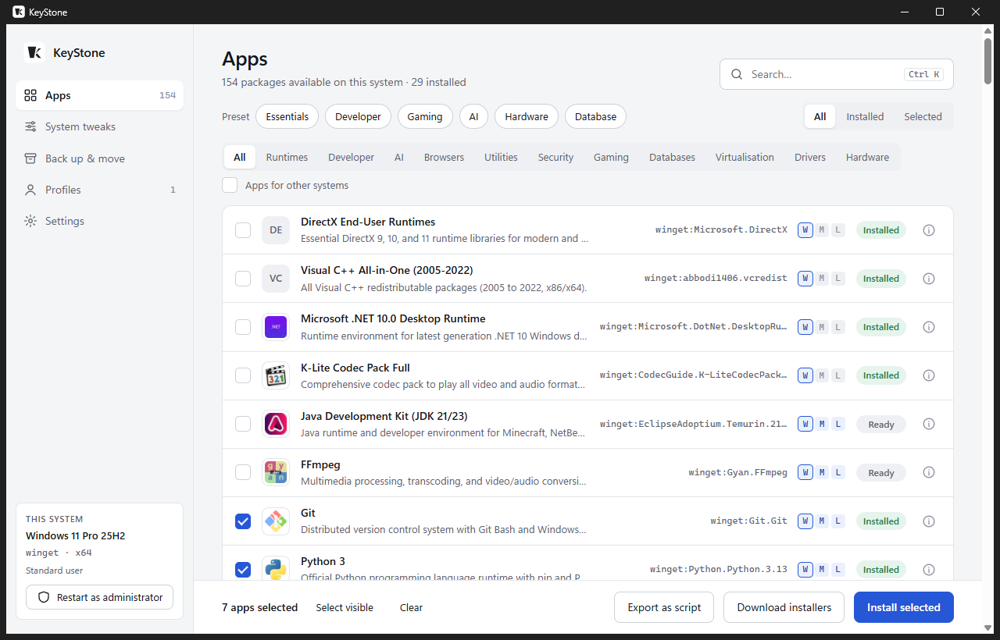
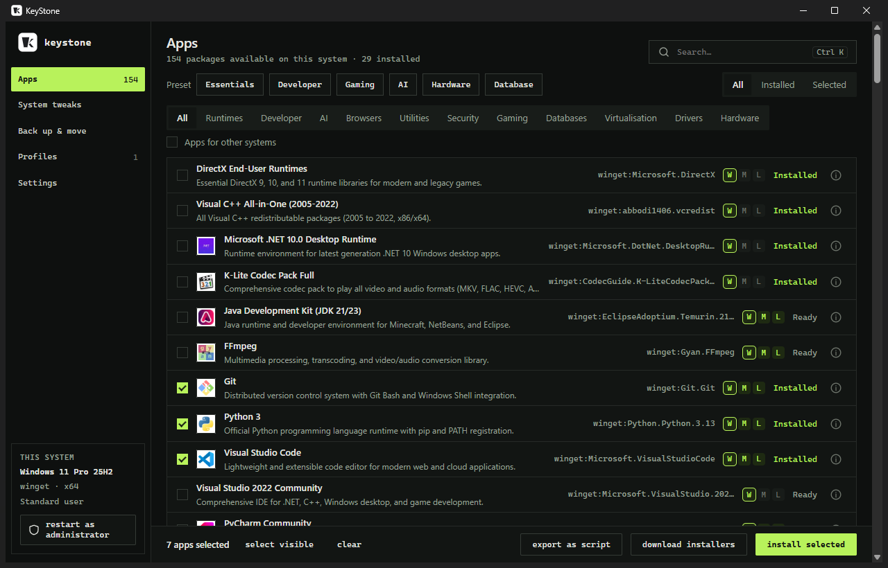
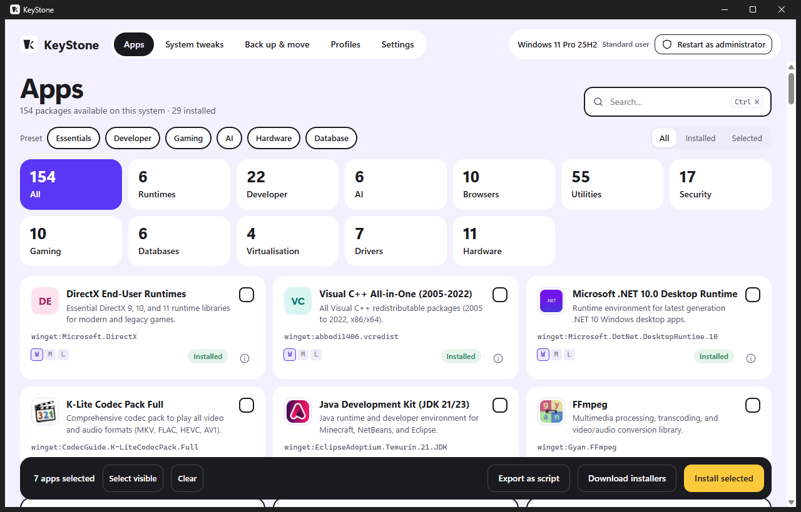
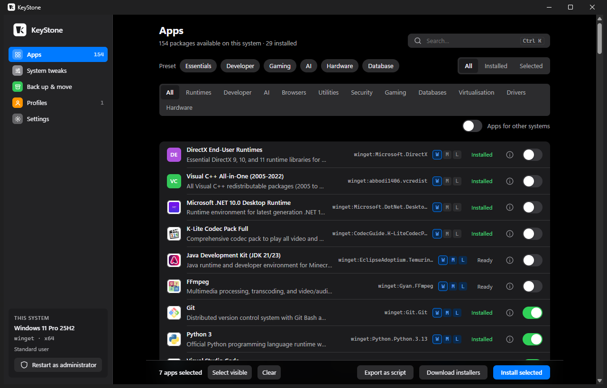
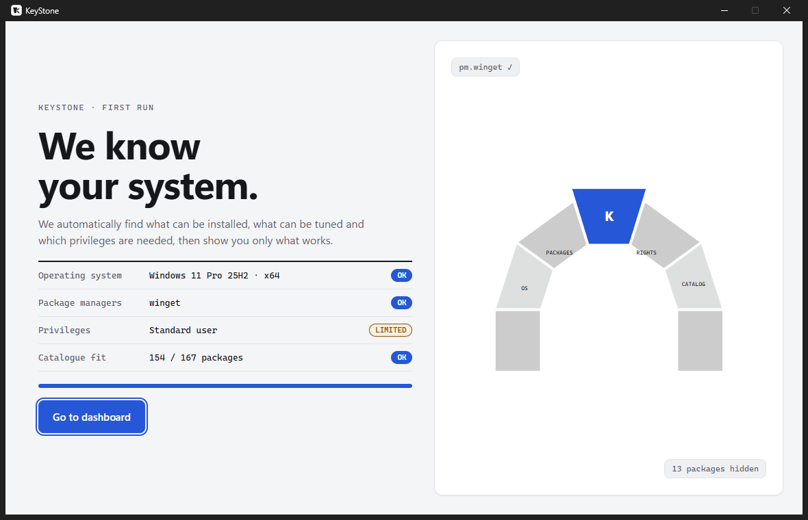
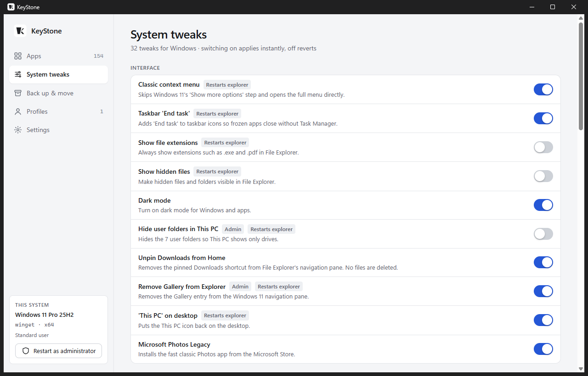
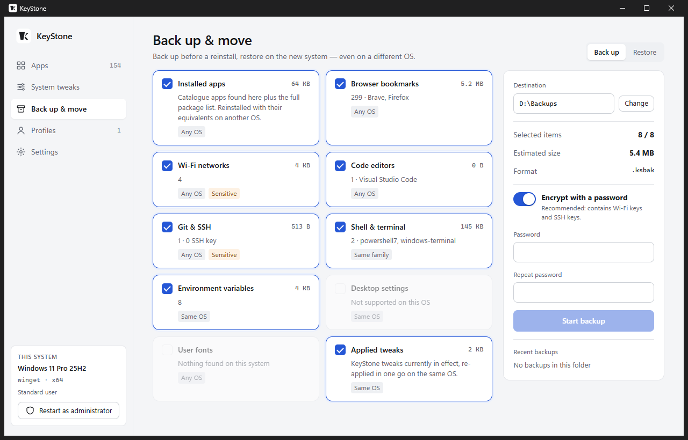
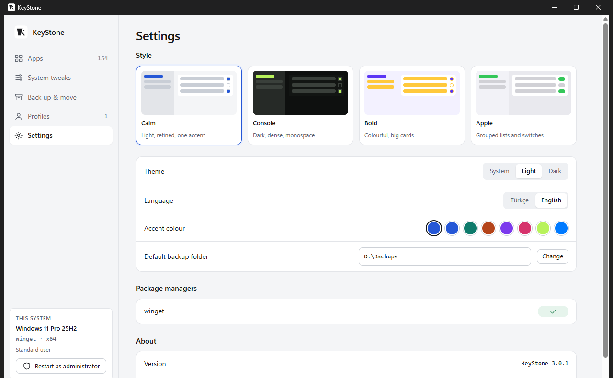

# KeyStone 3

**Back up before you format, set up after. On Windows, macOS and Linux.**

KeyStone gets a freshly installed computer ready from a single screen:

- installs apps silently with the system's own package manager,
- applies operating system tweaks and removes bloatware,
- backs up your settings to one file before a format, encrypted if you want,
- restores that backup on the new system, even if it runs a different OS.

| Calm | Console |
|---|---|
|  |  |
| **Bold** | **Apple** |
|  |  |

All four styles are built in and can be switched under **Settings → Style**. Each has light and dark themes, and the accent colour can be changed separately. The interface is available in English and Turkish.

## Features

### Welcome screen

On startup KeyStone detects the operating system, package managers and privilege level, then checks which catalogue packages work on this machine. The screen follows your chosen style.



### Apps: a catalogue of 167 packages

| System | Package manager | In catalogue |
|---|---|---|
| Windows 10/11 | winget (direct download as a fallback) | 154 |
| macOS | Homebrew (cask + formula) | 84 |
| Linux | apt / dnf / pacman / zypper + Flatpak + Snap | 62 |

- **Real app icons:** so you can tell the right program from one with a similar name. Icons are bundled, so they also work offline.
- **Distro detection:** Ubuntu, Mint, Fedora, Arch, EndeavourOS, openSUSE and others are recognised through `/etc/os-release`.
- **One password prompt (Linux):** repository refresh and install run as one privileged command, so pkexec asks once.
- **Linux source preference:** when an app is in both the distro repository and Flathub, a setting decides which one is used.
- **Presets:** Essentials, Developer, Gaming, AI, Hardware, Database.
- **Install script:** export your selection as a PowerShell or sh script.

### System tweaks: on applies instantly, off reverts



- **Windows (32):** classic context menu, taskbar "End task", file extensions, telemetry, location services, long paths, hibernation and more.
- **Remove bloatware (Windows):** OneDrive, Copilot, Teams, the new Outlook, Clipchamp and other pre-installed apps. Recall, Widgets and suggested apps are turned off by policy. Store apps can be reinstalled by switching the tweak off, except Microsoft News and Solitaire.
- **macOS (15):** Finder extensions and path bar, no .DS_Store on network or USB drives, Dock delay, fast key repeat, screenshot folder and more.
- **Linux (14):** GNOME dark theme, minimise/maximise buttons, battery percentage, swappiness, weekly SSD TRIM, Flathub, ufw and more.

Each tweak reads the live state, so the switch shows what is actually set on the system.

### Back up and move



| Item | Description | Restores on |
|---|---|---|
| Installed apps | Reinstalled with their equivalents on the other system | Any OS |
| Browser bookmarks | Chrome, Edge, Brave, Vivaldi, Opera, Arc, Firefox, plus one HTML file any browser can import | Any OS |
| Wi-Fi networks | Network name, security type and password (netsh / nmcli / networksetup) | Any OS |
| Code editors | VS Code, Cursor, VSCodium, Windsurf settings and extensions | Any OS |
| Git and SSH | `.gitconfig`, `~/.ssh` (file permissions preserved) | Any OS |
| Shell and terminal | zsh/bash/fish, Neovim, tmux and more, or PowerShell and Windows Terminal | Same family |
| Environment variables | The user PATH is merged, not overwritten | Windows |
| Desktop settings | GNOME dconf / macOS Dock and Finder | Same OS |
| Fonts | Fonts installed by the user | Any OS |
| Tweaks | KeyStone tweaks that are switched on | Same OS |

- **File format:** a backup is a single `.ksbak` file (zip + manifest). With a password it is encrypted with AES-256-GCM, using a key derived from the password with scrypt. A wrong password or a corrupted or truncated file is always detected.
- **Existing files are kept:** restore never overwrites a file. The old version is saved as `*.keystone-old`.
- **Preview first:** before restoring, you see what will be restored and which app maps to what, for example IINA for PotPlayer or Keka for WinRAR.

### Profiles

Each profile keeps its own selection of apps, tweaks and backup items. App ids are platform independent, so a profile works on every OS. Profiles can be exported and imported as `.ksprofile` files. KeyStone 2.x profiles are migrated automatically on first launch.



## Installation

Download the file for your system from the [Releases](../../releases) page:

- **Windows:** `KeyStone-windows-x64.exe`. Requires *App Installer* (winget) from the Microsoft Store.
- **macOS:** `KeyStone-macos-arm64.zip` (Apple silicon). Install Homebrew first from <https://brew.sh> if you do not have it. The app is unsigned, so right-click it in Finder and choose **Open** the first time.
- **Linux:** `keystone-linux-x64`. Make it executable with `chmod +x` and run it. The native window needs WebKitGTK (`gir1.2-webkit2-4.1`); without it, KeyStone opens in your browser instead.

### Run from source

```bash
python -m pip install -e ".[gui]"      # Python 3.10+
python -m keystone                     # native window
python -m keystone --serve             # in the browser (127.0.0.1, with a one-time token)
```

On Linux the native window also needs `sudo apt install python3-gi gir1.2-webkit2-4.1`, or your distro's equivalent.

### Command line

Everything also works without the interface when run from source:

```bash
keystone info                                    # detected system and package managers
keystone list --installed
keystone install vscode git firefox
keystone profile Developer install
keystone backup -o /media/usb --password         # encrypted backup
keystone restore backup.ksbak --password --plan  # only show what would happen
keystone tweaks apply show_file_extensions dark_mode
```

## Architecture

```
keystone/
  core/        system detection, paths, process running (cancel + elevation)
  pkg/         winget · brew · apt · dnf · pacman · zypper · flatpak · snap + resolver
  tweaks/      declarative tweak engine (registry / defaults / gsettings / files / commands)
  backup/      .ksbak archive, streaming encryption, backup items
  data/        catalog.json: single source, package ids per platform
  ui/          HTML/CSS/JS interface (no build step), 4 styles × light/dark, TR/EN
  api.py       the one surface the interface calls
  jobs.py      job queue + live event stream
  app.py       pywebview window (WebView2 / WKWebView / WebKitGTK)
  server.py    browser mode (127.0.0.1 only, Host check, token required)
```

- **Why pywebview:** no browser is bundled as in Electron; each OS's own web engine is used. The file stays small, the app starts fast and the Python logic from 2.x could be reused.
- **Why no build step:** the interface is plain HTML/CSS/JS, so developing or building it does not need Node.js.

## Development

```bash
python -m pip install -e ".[dev]"
python -m pytest            # tests never touch a real package manager
python tools/build.py       # single-file build for this OS
python tools/fetch_icons.py # refresh bundled app icons after catalogue changes
```

When a `v*` tag is pushed, GitHub Actions:

1. runs the tests on Windows, macOS and Ubuntu,
2. produces three builds (Windows x64, macOS arm64, Linux x64),
3. attaches them to a GitHub release.

## License

MIT
